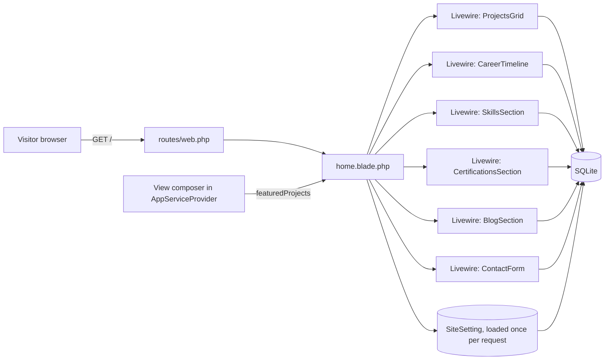

# Architecture

How the portfolio is put together, and why.

## In one paragraph

A **Laravel 13** app that renders one public page (the portfolio) and a small blog. The interactive parts of the page (project filter and popup, timeline, skills filter, contact form) are **Livewire** components. All content lives in a **SQLite** database and is edited in an admin panel built with **Filament**. There is no separate API and no JavaScript framework: the server renders HTML, Livewire swaps the changed parts, and Alpine.js handles small things like the mobile menu.

## Stack

| Layer | Tool | Used for |
| --- | --- | --- |
| Framework | Laravel 13 (PHP 8.3+) | Routing, models, mail, validation, rate limiting |
| Interactive UI | Livewire 4 | Project grid and popup, timeline, skills, certifications, blog teaser, contact form |
| Admin panel | Filament 5 | `/admin`: forms and tables for every kind of content |
| Styling | Tailwind CSS 4 (via Vite) | All styling; no component library |
| Small interactions | Alpine.js (bundled with Livewire) | Mobile menu, popup focus trap and Escape key |
| Hero animation | Plain JavaScript (`resources/js/workspace-hero.js`) | 3D scene of the featured-project cards (laptop and up): each card floats at its own depth (`data-depth`), leans toward the cursor and gets a moving shine; the stack tilts a few degrees and the glows behind move the other way. Runs only while the hero is on screen, and shows one still frame for visitors who prefer reduced motion |
| Card tilt | Plain JavaScript (`resources/js/tilt.js`) | Elements marked `data-tilt="light"` (white cards) or `data-tilt="dark"` lean up to 6 degrees toward the mouse with a light that follows it; `data-spot` gives only the light (stat tiles). Used on project cards, certification cards and the timeline's sub-project cards |
| Database | SQLite | Content, settings, messages, sessions, cache |
| Packaging | Docker | One image that builds the assets and serves the site |

## How a page request works



1. `GET /` renders `resources/views/home.blade.php` inside the layout `resources/views/components/layouts/app.blade.php` (navigation, SEO tags, footer).
2. A **view composer** in [AppServiceProvider](../app/Providers/AppServiceProvider.php) hands the home view the *featured and published* projects (up to 7, in the order set by `sort_order`), which become the **hero slider**, plus the names for the technology ticker. On laptops the slider is a stack of floating cards; on phones and tablets the same projects are a swipeable row of cards.
3. Each section is a Livewire component that queries its own data. After the first load, clicking a filter or opening a project sends a small request to `/livewire/...` and only that section is redrawn.
4. Text and links (name, tagline, stats, contact details, About text, CV link) come from **Site Settings**, not from the templates.

### Routes

| Route | Purpose |
| --- | --- |
| `/` | The portfolio page |
| `/blog`, `/blog/{slug}` | Blog list (9 per page) and a single published post |
| `/sitemap.xml`, `/robots.txt` | For search engines. `robots.txt` blocks `/admin` and points to the sitemap |
| `/admin` | Filament admin panel (login only, no sign-up) |
| `/up` | Health check, returns 200 when the app boots |

## Data model

The tables are independent: there are no foreign keys or relations between them.

| Table | Model | Shown on the site as | Notes |
| --- | --- | --- | --- |
| `projects` | `Project` | Project cards, the popup, and the hero card stack | `is_published` hides it; `is_featured` puts it in the hero. Case-study fields: `my_role`, `challenge`, `solution`, `outcome` |
| `work_experiences` | `WorkExperience` | The career timeline | Newest `start_date` first. `bullets` and `sub_projects` are JSON. `additional_periods` (JSON) holds extra time periods for the same role; `allPeriods()` returns the main one first, then the extras |
| `skills` | `Skill` | Skills section, filterable by category | `is_visible` hides it; listed by category then `sort_order`. The `icon` and `proficiency` columns exist but are not used by the site or the admin form |
| `certifications` | `Certification` | Certifications section | `is_visible` hides it |
| `blog_posts` | `BlogPost` | `/blog`, plus the latest 3 on the home page | Public when `is_published` is on and `published_at` is empty or not in the future (so a future date schedules it) |
| `contact_messages` | `ContactMessage` | Admin → Contact Messages only | Written by the contact form |
| `site_settings` | `SiteSetting` | Text and links across the whole site | Key/value pairs, see the admin guide |
| `users` | `User` | Admin logins | Created from the command line only |
| `cache`, `jobs`, `sessions` | Laravel | Internal | Sessions and cache use the database driver |

### Site Settings and the per-request cache

`SiteSetting::get('key', 'default')` is called about 20 times per page. To avoid 20 queries, [SiteSetting](../app/Models/SiteSetting.php) loads *every* setting once per request and serves later reads from memory (a `scoped` binding registered in `AppServiceProvider`). Saving or deleting a setting clears that copy. Helpers:

- `SiteSetting::url('cv_url')` returns a full URL, accepting either an absolute link or a path inside `public/`.
- `SiteSetting::pairs('hero_stats')` parses `value | label` lines.

## Where things live

```
app/
  Filament/Resources/    One folder per admin screen: Resource, Schemas (form), Tables (list), Pages
  Livewire/              One class per interactive section of the page
  Mail/                  ContactMessageReceived (the email you receive)
  Models/                Eloquent models; SiteSetting also holds the settings helpers
  Providers/             AppServiceProvider (composer, HTTPS, settings cache), Filament panel config
  Support/TechnologyColors.php   Colours for skill categories and tech tags
config/skill-categories.php      Categories and which technology belongs to which colour
database/
  migrations/            Table definitions
  seeders/               DatabaseSeeder, PortfolioSeeder (sample content), ProjectsSeeder (sample projects, safe to re-run), SiteSettingsSeeder (defaults)
resources/
  views/                 home, blog/, sitemap, mail/, components/layouts/app, livewire/*
  css/app.css            Tailwind 4 setup, theme, design-system classes (gradient text, reveal, ticker, hero cards), blog body styles
  js/                    app.js (entry, scroll reveal) and workspace-hero.js (hero animation)
routes/web.php           The few public routes
tests/Feature/           Automated tests (see below)
docs/                    This documentation
Dockerfile, docker-entrypoint.sh   Container build and start-up
```

## The contact form, step by step

[ContactForm](../app/Livewire/ContactForm.php) is the only place visitors write data.

1. Fields are checked when the visitor leaves each one, and again on send.
2. If the hidden "website" field has text, it was filled by a bot: the form shows "Message sent" but **nothing is saved or emailed**.
3. A visitor may send **3 messages per 10 minutes** (counted by IP address). More than that shows a friendly error.
4. The message is saved to `contact_messages`.
5. It is emailed to the `email` Site Setting (falling back to the mail "from" address). The email has a Reply-To of the sender. The email is sent immediately, not queued, because no queue worker runs. If the mail server is down the error is logged, and the visitor still sees success because the message is already saved.

The IP-based limit relies on the app trusting the hosting platform's proxy headers (`trustProxies` in [bootstrap/app.php](../bootstrap/app.php)); otherwise every visitor would look like the proxy.

## Admin access

Filament refuses access outside `APP_ENV=local` unless the user model says it is allowed. [User](../app/Models/User.php) implements `FilamentUser` and returns `true`, which is safe because the panel has no registration page and users can only be created with `php artisan make:filament-user`. Anyone who exists in the `users` table is an admin.

## Design system

A dark, glowing hero and dark sections for Experience and Contact, with tinted light sections between them, serif display type, small monospace labels and glass cards.

| Piece | Where | What it does |
| --- | --- | --- |
| Colours | Tailwind classes in the views | Ink `stone-950` and paper `stone-50`/white, violet as the main accent, emerald as the second. The signature gradient (violet, pink, emerald) is the `.text-gradient` class and `from-violet-600 to-fuchsia-500` on buttons |
| Type | `resources/css/app.css` | **Instrument Serif** for display text, **DM Sans** for body, **DM Mono** for labels. Sizes are deliberately modest: the page title tops out at about 5.5rem, section titles at 3rem |
| Light/dark rhythm | `home.blade.php` | Dark: hero, Experience, Contact (and the footer). Warm grey (`stone-100`): About, Skills, Blog. Soft lavender (`violet-100/70`): Projects, Certifications. The page is never plain white, so white cards stand out |
| Compact scale | `html` rule in `app.css`, `wide` breakpoint | From 1200px up the root font size is 80%. Everything is sized in `rem`, so the whole page shrinks evenly: the look of browser zoom 80% at 100%. Use `rem` (not `px`) for new sizes or they will not scale. `wide:` is the Tailwind prefix for 1200px and up |
| Badges | `projects-grid`, `skills-section` | Filter chips are neutral with a small coloured dot per category; the active one is solid dark. Project chips show how many projects use each technology, most used first, with a `+N more` button for the rest. Skill categories are one segmented control. Card tags are small grey tags with a coloured dot; the featured mark is a star badge |
| Section opener | `components/section-heading.blade.php` | `<x-section-heading number label title :dark>`: numbered mono label, title, optional subtitle |
| Blog card | `components/blog-card.blade.php` | One card used on the home page and on `/blog` |
| Gradient fallback | `app/Support/Gradient.php` | Projects and posts without an image get a stable gradient (the same title always gets the same one) with two-letter initials as a watermark |
| Navigation | `components/layouts/app.blade.php` | A floating pill. It starts light-on-dark over a dark top and turns white once you scroll. Pages with a dark top pass `:hero-dark="true"` (home, blog list, blog post) |
| Hero slider | `home.blade.php`, `workspace-hero.js` | Floating glass cards on laptops, a swipeable row on phones and tablets |
| Technology ticker | view composer in `AppServiceProvider` | The scrolling strip under the hero shows the first 18 visible skills |
| Scroll spy | `initScrollSpy` in `resources/js/app.js`, `.nav-underline` in `app.css` | Links marked `data-spy-link` point at `/#section`. As you scroll, the section that has passed about a third of the screen becomes active: its link turns darker (`aria-current="location"`) and a gradient underline slides under it in the top bar (the menu on phones and tablets highlights the link instead). Nothing happens on pages without those sections, such as the blog. The underline stops animating for visitors who prefer reduced motion |
| Scroll reveal | `resources/js/app.js` + `.reveal` in `app.css` | Elements with `reveal` rise and turn toward you (a small 3D tilt) once as they scroll into view |
| 3D details | `app.css`, `career-timeline.blade.php` | Timeline dots are shaded like small spheres (inset highlight and shadow) |

### Phones and tablets

- **Breakpoints.** The links in the top bar only appear from `lg` (laptops, 1024px and up). Phones and tablets get the menu button, so the bar never gets cramped.
- **Tap targets.** Buttons and links are at least 40px tall on touch-size screens.
- **Projects and certifications grids.** 1 column on phones, 2 on tablets, 3 on small laptops and 5 from 1200px (`wide:`). These two sections are also wider than the others at that size.
- **Wide rows scroll instead of wrapping.** The project and skill filters are one swipeable row on phones and wrapping chips from `sm` up. The hero projects are a swipeable row below `lg`.
- **The project popup** is a full-screen sheet on phones and a centred card from `sm` up.
- **No sideways scrolling.** `body` clips horizontal overflow, and grid columns that hold a scrolling row use `minmax(0, 1fr)` so the row can never stretch the page.

### 3D effects: where they run

- **Laptop-size screens with a mouse only.** `tilt.js` checks `(hover: hover) and (pointer: fine) and (min-width: 1024px)`. Phones and tablets get no tilt, and the hero cards are a flat swipeable row there.
- **Reduced motion.** Visitors who ask for less motion get no tilt, no floating and no entrance turn.
- **To tilt another element,** add `data-tilt="light"` (on a white background) or `data-tilt="dark"`. The element needs a rounded shape of its own (`rounded-*`) so the light stays inside it.
- **Entrance animations use `backwards`, not `both`.** A finished `both` animation keeps its last `transform` and would stop the card from tilting.
- **Tailwind's `hover:-translate-y-*` uses the separate `translate` property,** so it combines with the tilt, which uses `transform`.

### Things to know when changing the design

- **Reduced motion.** Visitors who ask their device for less motion get no scroll reveal, no ticker movement, no card entrance animation and a still hero. Keep any new animation behind `prefers-reduced-motion`.
- **No JavaScript.** `.reveal` only hides content when the `js` class is present on `<html>` (a one-line script in the head sets it), so the page is fully readable without JavaScript.
- **Livewire content.** Put `.reveal` only on static markup. Livewire redraws its own sections, which would reset the animation state. Cards inside Livewire components use the `card-in` entrance animation instead.
- **Tailwind classes must be written out.** Tailwind builds only class names it can find as whole words in the code. `sm:grid-cols-{{ $n }}` produces nothing; write `[1 => 'sm:grid-cols-1', 2 => 'sm:grid-cols-2'][$n]` instead (the stats row and case-study grid do this).
- **Blade evaluates component attributes more than once.** An attribute such as `:number="$counter()"` that changes a counter on every call gives wrong numbers. The section numbers use a plain lookup (`$num('projects')`) for that reason.
- **A scrolling row inside a grid needs `minmax(0, 1fr)`.** Without it the grid column grows to fit the row and pushes the whole page wider than the screen.
- **Check it visually.** Tests prove the markup is right, not that it looks right. Open the page at phone, tablet and laptop widths after a design change.

## Build pipeline

- **Vite** compiles `resources/css/app.css` and `resources/js/app.js` into `public/build`. Tailwind 4 reads class names straight from the source files (no config file), so a class that appears nowhere in the code does not exist in the CSS.
- The Docker image runs `npm run build` in a separate stage, so the final image carries only the compiled assets.

## Security notes

- Visitor text is always escaped when displayed. Rich-text fields written in the admin (blog body, project description) are printed as HTML, which is acceptable because only admins can write them.
- Admin pages require login; there is no public registration.
- Contact form: honeypot, rate limit, validation, and nothing is trusted from the browser.
- HTTPS is forced in production, and for local tunnels that forward over HTTPS.
- `target="_blank"` links carry `rel="noopener"`.

## Tests

`php artisan test` runs 54 tests against an in-memory database: home page and its share tags, blog routes and scheduling, contact form (saving, mail, honeypot, rate limit), project filter and popup, case-study display, hidden skills, company link and certificate image, hero card positions, settings, sitemap and robots, seeding that must not overwrite edits, and admin access outside the local environment.

## Known limitations

- **Hero card positions** are hand-picked only for the seeded projects (`top_class` / `left_class`, set by the seeder because the admin form has no fields for them). Any other featured project is placed automatically in a free spot from a fixed list of seven, by its order. If you want a particular spot for a new project, set those two columns to values that already exist in the compiled CSS (for example `top-[38%]`), since Tailwind builds only classes it can find in the code.
- **Unused columns:** `skills.icon` and `skills.proficiency` stay in the database but nothing shows them, and the admin form no longer offers them. `work_experiences.sort_order` is saved, but the timeline orders by start date.
- **SQLite on a container disk** is lost on redeploy unless a persistent disk is attached (see [deployment.md](deployment.md)).
- `php artisan serve` is the web server inside the container, which is fine for a portfolio but not built for heavy traffic.
