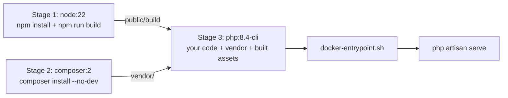

# Running and deploying

How to run the site on your computer, how the Docker image works, and what to set when you host it.

## Run it locally

You need PHP 8.3+, Composer and Node 22+.

```bash
composer install
npm install
cp .env.example .env
php artisan key:generate
touch database/database.sqlite     # the SQLite database file
php artisan migrate
php artisan db:seed                # sample content, only on a new database
php artisan storage:link           # makes uploaded images visible
php artisan make:filament-user     # your admin login

npm run dev                        # terminal 1: compiles CSS/JS as you edit
php artisan serve                  # terminal 2: http://localhost:8000
```

Admin: `http://localhost:8000/admin`.

Emails: with the default `MAIL_MAILER=log`, contact-form emails are written to `storage/logs/laravel.log` instead of being sent. Set the `MAIL_*` values in `.env` to send real mail.

Tests: `php artisan test`.

## How the Docker image works

The `Dockerfile` has three stages. Only the last one ends up in the image you run.



1. **Stage 1 (frontend):** installs npm packages and runs `npm run build`, producing the compiled CSS and JS.
2. **Stage 2 (vendor):** installs the PHP packages without development tools.
3. **Stage 3 (runtime):** PHP 8.4 with SQLite support. It copies in your code, the PHP packages and the built assets, creates Laravel's storage folders, and starts [docker-entrypoint.sh](../docker-entrypoint.sh).

`.dockerignore` keeps `.env`, `vendor`, `node_modules`, logs, and any local database file out of the image. Secrets never get baked in; they are supplied as environment variables when the container starts.

### What happens each time the container starts

[docker-entrypoint.sh](../docker-entrypoint.sh) runs these steps, in order:

| Step | Why |
| --- | --- |
| Create the SQLite file (and its folder) if it is missing | A brand-new container has no database yet. Skipped when `DB_CONNECTION` is not `sqlite` |
| `php artisan storage:link --force` | Makes uploaded images reachable at `/storage` |
| `php artisan migrate --force` | Creates or upgrades the tables |
| `php artisan db:seed --force` | Loads sample content on a **new** database; on an existing one it only adds missing settings. It never overwrites edits |
| `php artisan serve` on `$PORT` (default `10000`) | Starts the site, with 4 worker processes |

All steps are safe to repeat, so restarting or redeploying will not wipe your content *as long as the database file survives* (see below).

### How seeding decides what to do

`php artisan db:seed` runs [DatabaseSeeder](../database/seeders/DatabaseSeeder.php):

- **No settings exist yet** (a new database): it runs `PortfolioSeeder`, which loads the sample projects, experience, skills and certifications, plus the default settings.
- **Settings already exist**: it runs only `SiteSettingsSeeder`, which adds any *missing* setting keys (for example new ones introduced by an update) and keeps every value you edited.

Two commands to be careful with:

| Command | Effect |
| --- | --- |
| `php artisan db:seed --class=SiteSettingsSeeder` | Safe. Adds missing settings only |
| `php artisan db:seed --class=PortfolioSeeder` | **Destructive.** Empties projects, experience, skills and certifications, then reloads the sample data |

## Environment variables to set on your host

| Variable | Value |
| --- | --- |
| `APP_ENV` | `production` |
| `APP_DEBUG` | `false` |
| `APP_KEY` | Generate with `php artisan key:generate --show` and keep it secret |
| `APP_URL` | Your site's address, e.g. `https://yourname.com`. Used for the sitemap, share tags and image links |
| `DB_CONNECTION` | `sqlite` |
| `DB_DATABASE` | Path of the database file. Use a path on a persistent disk (below) |
| `MAIL_MAILER`, `MAIL_HOST`, `MAIL_PORT`, `MAIL_USERNAME`, `MAIL_PASSWORD`, `MAIL_FROM_ADDRESS` | A real mail service, so contact-form emails arrive |
| `PORT` | Usually provided by the host |

Admin access works with `APP_ENV=production`: the `User` model explicitly allows panel access (see [architecture.md](architecture.md)).

The site trusts the host's proxy headers (`X-Forwarded-For` and `X-Forwarded-Proto`) so each visitor has a real IP address for the contact form limit, and HTTPS links are generated correctly. Only run it behind a proxy or load balancer that sets them, which platforms like Render and AWS load balancers do.

## Keeping your data between deploys

A container's disk is **thrown away on every redeploy**. That includes:

- the SQLite database (all your content, settings and messages), and
- uploaded images (`storage/app/public`: project thumbnails, blog covers).

Without a persistent disk, a redeploy brings back the sample content and loses every admin change. To avoid that:

1. Attach a **persistent disk/volume** to the service (for example mounted at `/var/data`).
2. Set `DB_DATABASE=/var/data/portfolio.sqlite`. The start script creates the file there on first run.
3. Keep uploads on the same disk, either by also mounting `storage/app/public` on persistent storage, or by moving uploads to S3.

If your host has no persistent disk (some free tiers), treat the **seeders as the source of truth**: edit `database/seeders/PortfolioSeeder.php` and `SiteSettingsSeeder.php`, and redeploy. The admin panel is then only good for previewing until the next deploy.

## Hosting checklist

- [ ] Environment variables above are set, especially `APP_KEY` and `APP_URL`
- [ ] A persistent disk is attached and `DB_DATABASE` points to it
- [ ] Real `MAIL_*` credentials are configured, and a test message through the contact form arrives
- [ ] `/admin` login works (create the first user with `php artisan make:filament-user` inside the container, or locally against the same database)
- [ ] In Site Settings, `cv_url`, `og_image` and `about_text` are filled in
- [ ] `/sitemap.xml` and `/robots.txt` show your real domain
- [ ] `/up` returns OK (use it as the host's health check)

## Common problems

| Problem | Cause and fix |
| --- | --- |
| `/admin` shows 403 | Fixed in the code (`User` implements `FilamentUser`). If it returns after an update, check that `app/Models/User.php` still has `canAccessPanel` |
| Uploaded images give a 404 | `php artisan storage:link` has not run (the Docker start script does it), or the upload disk was wiped by a redeploy |
| Your edits vanished after a deploy | The database lived on the container disk. Attach a persistent disk and set `DB_DATABASE` |
| No emails arrive | `MAIL_MAILER` is still `log`. Set real `MAIL_*` values. Messages are still saved in Admin → Contact Messages |
| New CSS classes do nothing | The frontend needs a rebuild: `npm run build` (Docker does it for you) |
| Everyone gets "too many messages" | The host's proxy headers are not trusted or not sent, so all visitors share one IP address |
